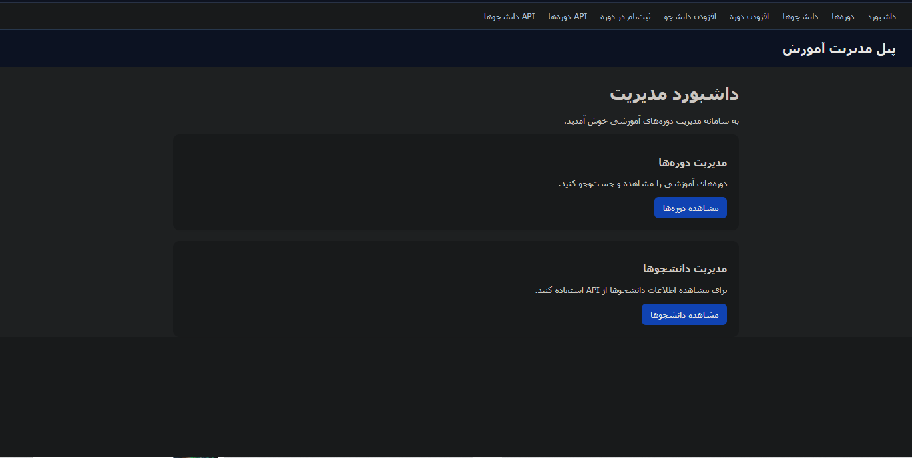
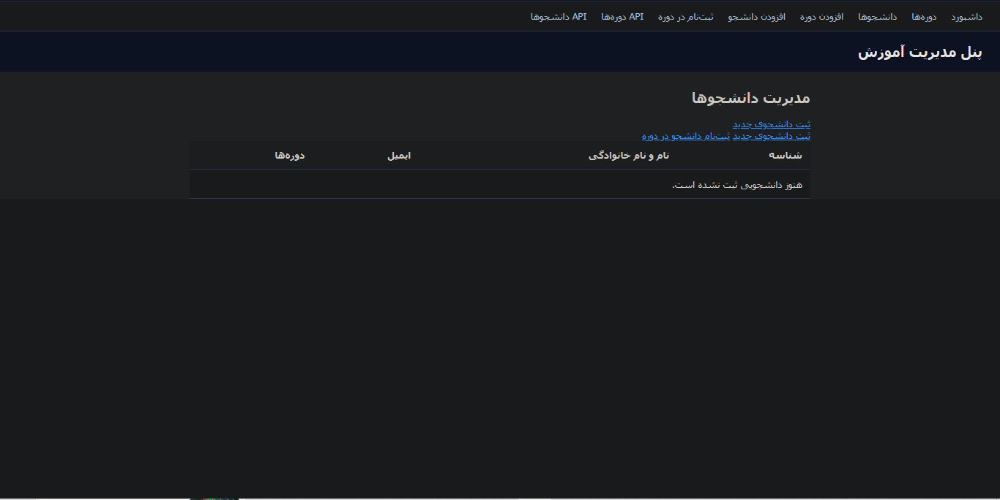
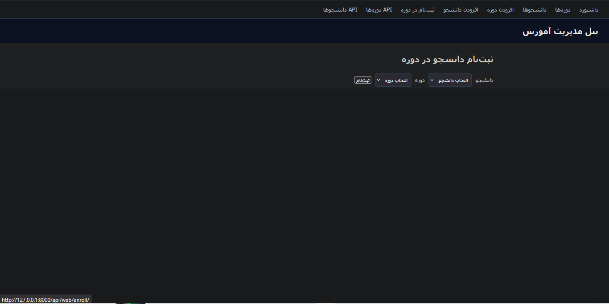
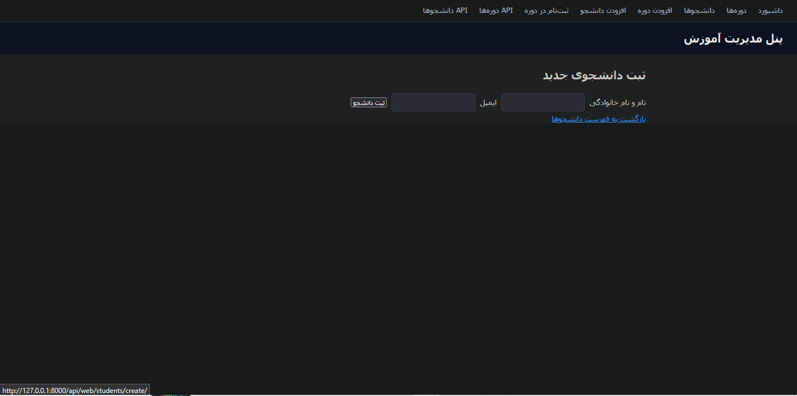

# Course Management System

A Django-based course management system built with Python, Django and PostgreSQL.

## Features

- Course management (CRUD)
- Student enrollment
- Course capacity management
- Search and filtering
- REST API
- PostgreSQL database
- Docker support

---

## Screenshots

### Home Page

### Courses Page

### Admin Panel

### student Page

